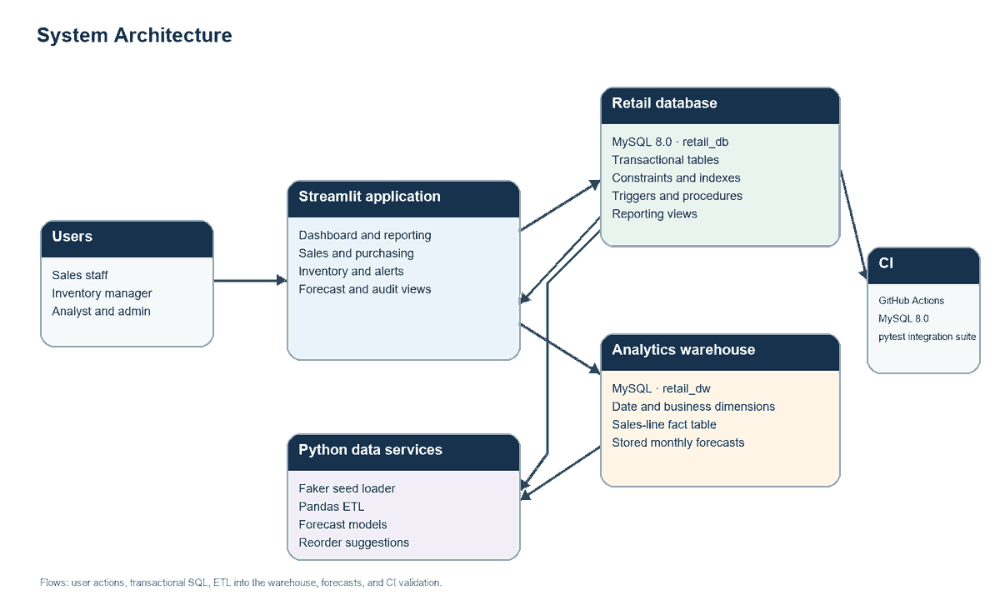

# Sales and Inventory Analytics Database

An RDBMS course project for retail operations and analytics. MySQL 8.0 stores products, inventory, suppliers, customers, employees, sales, and purchasing. Python loads reproducible sample data, builds a sales warehouse, compares demand forecasts, and serves a Streamlit application.

## Features

- Eleven normalized transactional tables with foreign keys and CHECK constraints.
- Product price history, audit log, and stock threshold alerts.
- Triggers for inventory creation, price history, audit events, sales totals, stock deductions, and alerts.
- Transactional procedures for placing an order and receiving a purchase order.
- Monthly sales, low-stock, and ABC reporting views, plus sixteen SQL analytics queries.
- An idempotent star-schema ETL, OLAP rollups, two forecast models, and reorder suggestions.
- Streamlit pages for Dashboard, Inventory, Sales, Purchasing, Forecast, and Audit log.
- pytest integration tests using `retail_db_test` and a MySQL 8.0 GitHub Actions service.

## Technology

MySQL 8.0, Python 3.10+, mysql-connector-python, pandas, NumPy, Faker, scikit-learn, SQLAlchemy, Streamlit, Plotly, pytest, and Graphviz.

## Architecture



The transactional source is `retail_db`. The ETL loads one warehouse fact per sales order line into `retail_dw`; the forecasting process stores next-month predictions there.

## Entity relationship diagram


The SVG and source generator are in `docs/`. `python docs/make_er.py` renders the ER diagram with Graphviz; both the Python Graphviz package and system `dot` executable must be installed.

## Windows and PowerShell setup

### Prerequisites

- MySQL Server 8.0 and MySQL command-line client.
- Python 3.10 or later.
- Graphviz, including the `dot` executable, to regenerate the diagrams.

### Create the Python environment

```powershell
py -3 -m venv .venv
.\.venv\Scripts\Activate.ps1
python -m pip install --upgrade pip
pip install -r requirements.txt
Copy-Item .env.example .env
```

Edit `.env` with local settings for `DB_HOST`, `DB_PORT`, `DB_USER`, `DB_PASSWORD`, and `DB_NAME`. Do not commit `.env`. The example file contains placeholders only.

### Initialize MySQL

Open PowerShell in the repository root and apply the transactional SQL in order:

```powershell
Get-Content -Raw sql\schema.sql | mysql.exe -u root -p
Get-Content -Raw sql\support_tables.sql | mysql.exe -u root -p
Get-Content -Raw sql\triggers.sql | mysql.exe -u root -p
Get-Content -Raw sql\procedures.sql | mysql.exe -u root -p
Get-Content -Raw sql\views.sql | mysql.exe -u root -p
```

Before applying `sql/roles.sql`, replace every sample role password with a strong local password. The committed values are placeholders and must be changed before use. Apply the role file as a MySQL administrator:

```powershell
Get-Content -Raw sql\roles.sql | mysql.exe -u root -p
```

`sql/support_tables.sql` and the trigger, procedure, view, and grant scripts can be reapplied. `sql/schema.sql` creates missing core tables and leaves existing tables intact. Use a clean database for a fresh setup.

## Run the project

### Seed the operational database

```powershell
python python\seed_data.py
```

The script refuses to seed a non-empty database. It creates 6 categories, 42 products, 10 suppliers, 8 employees, 300 customers, and 2,000 sales orders. Product triggers create inventory and price-history rows, while order-line triggers calculate totals and deduct stock.

### Run SQL analytics

```powershell
Get-Content -Raw sql\analytics_queries.sql | mysql.exe -u root -p retail_db
```

There are sixteen commented, read-only queries. `sql/index_demo.sql` compares an order-date range plan before and after adding `idx_order_date`; it leaves the index installed. See [docs/index_explain.md](docs/index_explain.md).

### Build the warehouse and forecast demand

```powershell
python python\etl.py
Get-Content -Raw sql\olap_queries.sql | mysql.exe -u root -p retail_dw
python python\forecast.py
```

The ETL creates `retail_dw` and its schema when needed. It upserts dimensions and sales facts, then checks that fact net revenue equals sales-order totals. The forecasting command reports MAE and MAPE by model and product and stores next-month predictions. To also create pending purchase orders for products that need restocking, run:

```powershell
python python\forecast.py --draft-orders
```

For Streamlit access to warehouse reporting, apply `sql/warehouse_grants.sql` after the warehouse exists:

```powershell
Get-Content -Raw sql\warehouse_grants.sql | mysql.exe -u root -p
```

### Start the application

```powershell
streamlit run python\app\main.py
```

The Sales page uses `place_order`; the Purchasing page uses `receive_purchase_order`. Database errors, including insufficient stock, appear as readable messages in the app.

## Tests

Tests create and drop only the dedicated databases `retail_db_test` and `retail_dw_test`. Confirm `TEST_DB_NAME=retail_db_test` in the environment before running them:

```powershell
$env:TEST_DB_NAME = "retail_db_test"
$env:TEST_DW_NAME = "retail_dw_test"
pytest -q
```

The test account needs permission to create and drop these test databases. The test fixture refuses to run if `TEST_DB_NAME` is anything other than `retail_db_test` or matches the configured `DB_NAME`. GitHub Actions starts MySQL 8.0 and runs this suite on pushes and pull requests.

## Project report

The college-format report is in [report/project_report.docx](report/project_report.docx). It includes the cover page, abstract, contents, figures and tables lists, requirements, scenarios, system design, normalization discussion, references, and SQL/query-output appendix. Replace `<REG_NO>` and `<SUPERVISOR_NAME>` before submission.

## Screenshots

Add screenshots of the running dashboard, inventory view, sales form, purchasing view, and forecast chart after launching the app against a populated local database.

## Project structure

```text
docs/       Requirements, decisions, ER design, architecture, use-case, and index notes
python/     Deterministic seed, ETL, forecasting, and Streamlit app
report/     College-format project report
sql/        Transactional, support, routine, view, analytics, and warehouse SQL
tests/      Separate-database MySQL integration suite
.github/    GitHub Actions workflow
```

## Security and data

All database credentials come from environment variables or a local `.env` file. Do not commit passwords, tokens, or keys. The role-account passwords in `sql/roles.sql` are samples; change them before use. The repository's generated retail data is synthetic.

