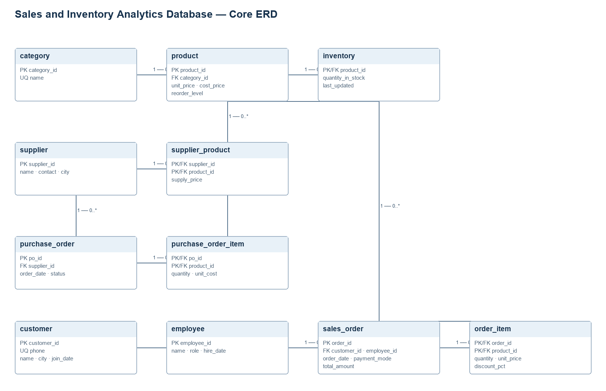

# Requirements and ER design

## Purpose

The system manages the daily retail transaction cycle and turns the resulting sales and inventory data into operational and analytical information. MySQL 8.0 is the transactional source of truth; Python provides repeatable data loading, warehouse ETL, forecasting, and the user interface.

## Functional requirements

1. Maintain product categories, products, suppliers, supplier offers, customers, employees, and stock.
2. Validate positive prices and quantities, non-negative stock and reorder levels, valid discounts, and referential integrity in MySQL.
3. Record sales with one or more order lines, selected payment mode, item-level discount, and a database-computed total.
4. Create purchase orders and receive a pending order exactly once, increasing inventory atomically.
5. Track product price changes, audit price updates, and record inventory crossing below its reorder threshold.
6. Provide monthly sales and profit, low-stock, and ABC classification reporting, plus sixteen analytical queries.
7. Seed a fresh database reproducibly, build an idempotent sales warehouse, measure forecast errors, and suggest restocking.
8. Expose dashboard, inventory, sales, purchasing, forecast, and audit views in a Streamlit application.

## Non-functional requirements

- Target MySQL Server 8.0 with InnoDB, `utf8mb4`, CHECK constraints, CTEs, window functions, and stored programs.
- Use parameterized SQL, transactions for multi-step operations, and environment-based secrets.
- Make seed loading fail safely on a non-empty retail database; make warehouse ETL safe to rerun.
- Keep data integrity in the database so multiple application clients share the same rules.
- Support Python 3.10 or later and Windows PowerShell developer setup.

## Actors and scenarios

| Actor | Scenario | Outcome |
|---|---|---|
| Sales staff | Place a sale for a customer with product quantities and discounts | Stock is checked and decremented; the order total is calculated atomically |
| Inventory manager | Maintain products and suppliers, review low stock, and draft/receive purchases | Stock and purchase status remain consistent |
| Administrator | Review reports, audit changes, and manage database access | Authorized access to analytical and administrative information |
| Analyst | Refresh the warehouse and compare demand models | Reconciled facts, model errors, and next-month product estimates |

## Data model summary

The ER diagram below shows the eleven core transactional tables. Product price history, audit logging, and stock alerts are supporting tables added in the next database milestone. Every entity has a surrogate primary key except the two associative tables, which use composite keys.

An SVG copy is provided at [er_diagram.svg](er_diagram.svg). The source generator is [make_er.py](make_er.py). It requires the Graphviz system executable (`dot`) as well as the Python `graphviz` package.

## Acceptance criteria

- SQL scripts apply to a clean MySQL 8.0 database and can be applied again according to each script's documented reset behavior.
- A successful sale or purchase receipt updates all related records within one transaction; a failed operation leaves no partial changes.
- Price history and stock-alert rows are produced by database triggers, not by the seed script.
- Warehouse net sales reconcile to transactional order totals.
- The application reads credentials from environment variables or a local `.env` file, never from committed secrets.

